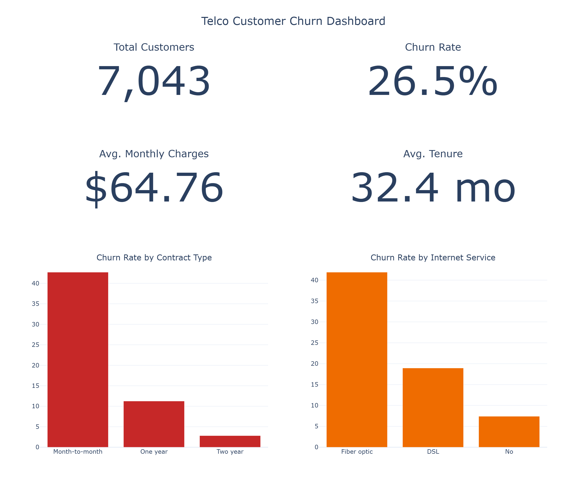
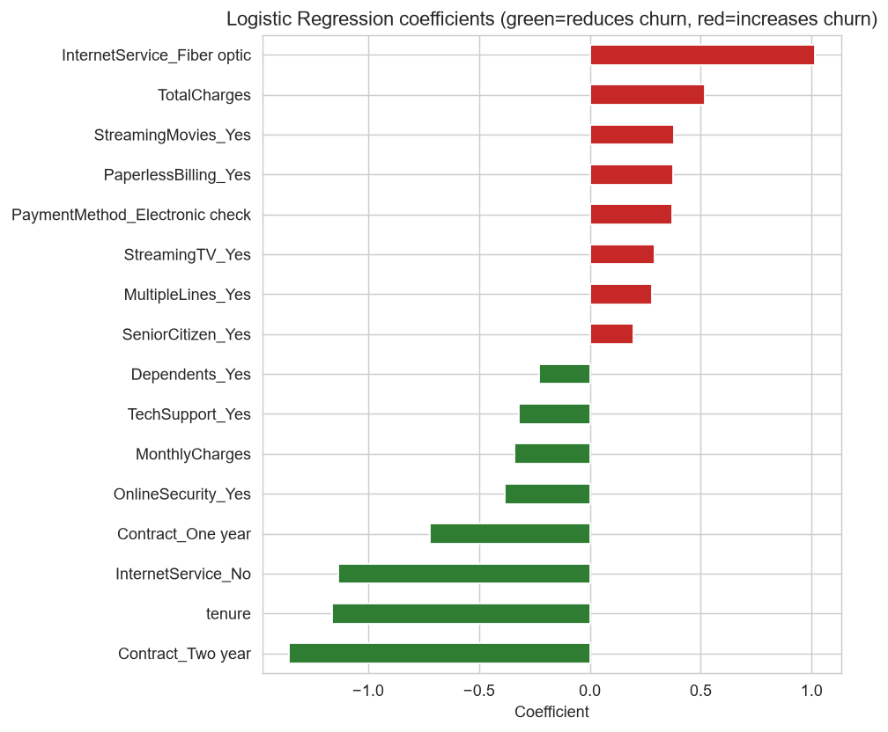
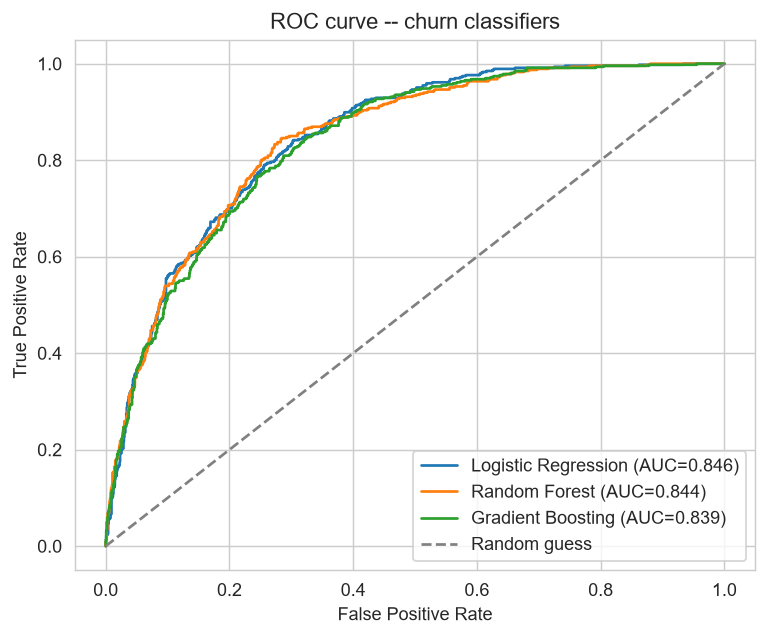

# 📉 Telco Customer Churn Analysis & Prediction

**EDA + classification modeling on 7,043 telecom customers — identifying the strongest, most actionable churn drivers and building a genuinely useful predictive model**

> Interactive dashboard: [dashboard/churn_dashboard.html](dashboard/churn_dashboard.html)

---

## Problem

A telecom provider has a 26.5% customer churn rate. Which customers are leaving, why, and can churn be predicted early enough to intervene?

**Research questions:**
- Which contract terms, services, and payment methods are associated with churn?
- Do newer or higher-paying customers churn more?
- Can churn be predicted reliably enough to be operationally useful — and unlike a similarly-shaped problem in my [coffee sales project](https://github.com/Valerie-komen/Coffee-Sales-Analytics-ML) (where the data didn't support a useful classifier), does this dataset actually have the class balance and signal to support one?

---

## Dataset

Source: IBM's Telco Customer Churn dataset — 7,043 customers, 21 fields (demographics, contract/account details, subscribed services, charges, churn status).

---

## Methods

| Layer | What it does | Files |
|---|---|---|
| **Cleaning** | Fix `TotalCharges` (blank for 11 zero-tenure customers, not corrupted — filled with 0, not dropped), collapse redundant categorical labels | [`notebooks/01_data_cleaning.ipynb`](notebooks/01_data_cleaning.ipynb) |
| **EDA** | Churn rate by contract/service/payment method, tenure and spend patterns, correlation analysis | [`notebooks/02_exploratory_analysis.ipynb`](notebooks/02_exploratory_analysis.ipynb) |
| **ML** | 3 classifiers (Logistic Regression, Random Forest, Gradient Boosting) predicting churn | [`notebooks/03_machine_learning.ipynb`](notebooks/03_machine_learning.ipynb) |
| **Dashboard** | Self-contained interactive HTML dashboard | [`dashboard/churn_dashboard.html`](dashboard/churn_dashboard.html) |

---

## Results

- **Contract length is the single strongest churn driver**: month-to-month customers churn at 42.7%, vs. 11.3% for one-year and just 2.8% for two-year contracts — a 15x spread.
- **Fiber optic internet customers churn at 41.9% vs. 19.0% for DSL.**
- **Electronic check payers churn at 45.3%**, more than double every other payment method.
- **Churners have less than half the tenure of retained customers** (18.0 vs. 37.6 months) and pay more per month on average ($74.44 vs. $61.27).



---

## Machine Learning

Unlike the repeat-purchase classification in my coffee sales project — where only 2.7% of customers were positive examples and no model beat a naive baseline — this dataset's 26.5% churn rate is balanced enough to support a genuinely useful classifier, tested honestly rather than assumed.

| Model | Test Accuracy | Precision (Churn) | Recall (Churn) | CV ROC-AUC (5-fold) |
|---|---|---|---|---|
| **Logistic Regression** | 0.750 | 0.52 | **0.80** | **0.845 (±0.014)** |
| Random Forest | 0.766 | 0.54 | — | 0.844 (±0.011) |
| Gradient Boosting | 0.796 | 0.65 | — | 0.840 (±0.010) |

Logistic Regression has the best cross-validated ROC-AUC and, unlike the tree models, gives directly interpretable coefficients — confirming the EDA findings quantitatively: two-year and one-year contracts are the strongest churn-*reducing* features; fiber optic internet and electronic check payment are among the strongest churn-*increasing* ones. At 80% recall on the churn class, the model catches 4 out of 5 customers who will actually leave — a reasonable trade-off for a retention-targeting use case, where the cost of a missed churner usually exceeds the cost of a false-positive retention offer.




---

## Installation

```bash
git clone https://github.com/Valerie-komen/Telco-Customer-Churn-Analysis.git
cd Telco-Customer-Churn-Analysis
pip install -r requirements.txt
```

## Reproducibility

1. **Data cleaning:** [`notebooks/01_data_cleaning.ipynb`](notebooks/01_data_cleaning.ipynb) → `data/cleaned_telco_churn.csv`.
2. **EDA:** [`notebooks/02_exploratory_analysis.ipynb`](notebooks/02_exploratory_analysis.ipynb).
3. **ML:** [`notebooks/03_machine_learning.ipynb`](notebooks/03_machine_learning.ipynb).
4. **Dashboard:** open [`dashboard/churn_dashboard.html`](dashboard/churn_dashboard.html) directly in a browser.

All notebook outputs in this repository are real, executed results.

---

## Repository Structure

```
Telco-Customer-Churn-Analysis/
├── README.md
├── requirements.txt
├── data/
│   ├── raw_telco_churn.csv
│   └── cleaned_telco_churn.csv
├── notebooks/
│   ├── 01_data_cleaning.ipynb
│   ├── 02_exploratory_analysis.ipynb
│   └── 03_machine_learning.ipynb
├── dashboard/
│   └── churn_dashboard.html
└── images/
```

---

## Limitations

- This is a well-known public benchmark dataset (IBM Telco Customer Churn), not proprietary business data — findings are directionally useful for demonstrating method, not literal business recommendations for any specific company.
- No data on customer support interactions, competitor pricing, or service-quality incidents, all of which likely matter for *why* fiber optic and electronic-check customers churn more, beyond what this dataset can explain.
- The model is trained on a single historical snapshot — a real deployment would need to monitor for drift as contract mix, pricing, and competitive pressure change over time.

---

*Questions or feedback? Feel free to open an issue or connect with me on LinkedIn.*
